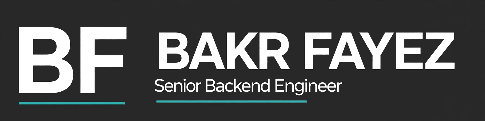

# Bakr Fayez

Security Researcher and Senior Backend Engineer. Founder of Nirous Labs and AhlanHost.

## Tech stack

## Featured

**[NAR Skill](https://github.com/BakrFayez/nar-skill)**. An AI agent skill for Android APK reverse engineering, built for all apps and games.

## Focus

Android, backend engineering, cybersecurity, reverse engineering, game development.

## Currently

Building Nirous Download Manager (NDM) and growing the NAR skill.
